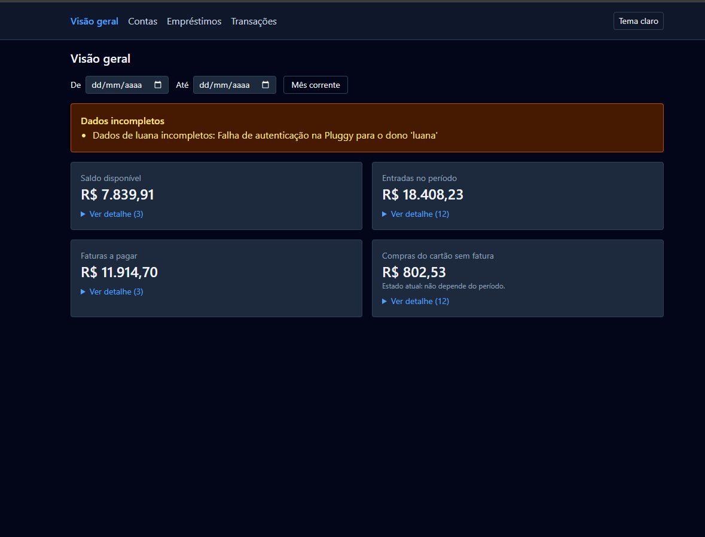

# financial-api-frontend

SPA em React + TypeScript (Vite) que consome a [`financial_api`](../financial_api) somente
para leitura e mostra a situação financeira de todos os donos de forma combinada.



## Requisitos

- Node.js 22.22 ou superior (o CI usa 24) e npm.
- `financial_api` rodando (padrão `http://localhost:8080`). Veja o README dela.

## Variáveis de ambiente

| Variável | Uso |
|---|---|
| `VITE_API_BASE_URL` | URL base que a SPA usa para chamar a API. Padrão `/api` |
| `VITE_API_KEY` | Chave de API, enviada no cabeçalho `X-API-Key` em toda chamada. Deve ser igual à `APP_API_KEY` da API. Vazia ou ausente: o cabeçalho não é enviado |
| `API_PROXY_TARGET` | Só em desenvolvimento: destino do proxy do Vite. Padrão `http://localhost:8080` |
| `BASIC_AUTH_USER` | Só no Heroku (nginx): usuário exigido para abrir a SPA. Obrigatória. Não pode conter `:` |
| `BASIC_AUTH_PASSWORD` | Só no Heroku (nginx): senha exigida para abrir a SPA, em texto, a mesma que você digita no navegador. Obrigatória |

Copie `.env.example` para `.env` para alterar `VITE_API_BASE_URL` e `VITE_API_KEY`.

As variáveis `VITE_*` são lidas no **build** e ficam gravadas no JavaScript publicado. Isso tem duas consequências:

- Quem abrir a SPA consegue ver a chave. Ela barra quem chama a API direto, mas não protege a própria SPA.
- No Heroku, `heroku config:set VITE_API_KEY=...` só reinicia o app e não gera um bundle novo. Para a chave valer ou mudar, faça um novo deploy (por exemplo, `git commit --allow-empty` e push). Defina a variável antes do primeiro build.

## Acesso à SPA no Heroku (Basic Auth)

No Heroku, o nginx (buildpack `heroku-community/nginx`) pede usuário e senha antes de entregar
qualquer arquivo da SPA, inclusive o bundle onde fica a chave de API. Existe uma única credencial,
compartilhada, definida por config vars:

```sh
heroku config:set BASIC_AUTH_USER=<usuario> BASIC_AUTH_PASSWORD=<senha> -a <app-frontend>
```

- Em cada início do dyno, o `Procfile` roda `bin/gen-htpasswd`, que lê as duas variáveis, calcula o
  hash da senha com `openssl passwd -apr1` e grava `/app/.htpasswd` (fora do `dist/`, não é servido
  e não vai para o repositório). Só depois o nginx sobe.
- **Sem uma das variáveis, em branco, ou com `:` no usuário, o dyno não sobe.** O log cita o nome da
  variável ou a regra, sem mostrar valores. Defina as variáveis antes do deploy.
- Trocar a credencial é `heroku config:set` e o reinício do dyno. Não precisa de novo build nem de
  novo deploy, ao contrário do `VITE_API_KEY`.
- O acesso por http é redirecionado para https antes de pedir a senha.
- A senha não pode conter quebra de linha.
- Em desenvolvimento (`npm run dev`) não há Basic Auth, porque o Vite não passa pelo nginx.

## Comandos

```sh
npm install
npm run dev     # servidor de desenvolvimento em http://localhost:5173
npm run build   # verificação de tipos e build de produção em dist/
npm test        # testes (Vitest)
```

## Como a SPA fala com a API

A API usa a porta 8080, exige o cabeçalho `X-API-Key` em toda rota e só aceita chamadas de navegador
das origens listadas em `APP_CORS_ALLOWED_ORIGINS`. Em desenvolvimento, o Vite serve a SPA na porta
5173 e repassa `/api/*` para a API (removendo o prefixo `/api`), então o navegador só fala com a
própria origem. O proxy repassa o `X-API-Key`.

Em produção não há esse proxy. Há duas opções:

- Sirva `dist/` e a API sob o mesmo domínio (por exemplo, um nginx que encaminha `/api` para a API).
- Aponte `VITE_API_BASE_URL` para a URL da API e inclua a origem da SPA em `APP_CORS_ALLOWED_ORIGINS`
  na API (esquema e porta, sem barra no final).

Uma chave ausente ou errada gera 401, e a tela mostra a mensagem devolvida pela API.

## Integração contínua

O workflow `.github/workflows/ci.yml` roda em todo pull request (aberto ou atualizado) e em
todo push na `master`: `npm ci`, `npm run lint`, `npm test` e `npm run build`. Um passo que
falha interrompe os seguintes e deixa o check `ci` vermelho. O build inclui `tsc -b`, que
checa tipos.

O workflow sozinho não bloqueia o merge. Para bloquear, marque o check `ci` como obrigatório
em Settings, Branches, na regra de proteção da `master`.

## Telas

| Rota | O que mostra |
|---|---|
| `/` | Visão geral: totais do período (`/summary`) |
| `/accounts` | Contas, cartões e faturas |
| `/transactions` | Transações de todas as contas |
| `/loans` | Empréstimos e financiamentos, com saldo para quitar, parcelas e último pagamento |

## Limitações

- A API só confere a chave de API, que fica no JavaScript da SPA. No Heroku, o nginx pede uma senha compartilhada antes de entregar a SPA, mas quem tem a senha ainda vê a chave no bundle. Não há login por usuário, logout nem limite de tentativas.
- Visão somente leitura e combinada, sem filtro por dono.
- Empréstimos: a API não informa o valor da parcela mensal, e a tela não soma saldos. Os empréstimos ainda não entram na visão geral.
